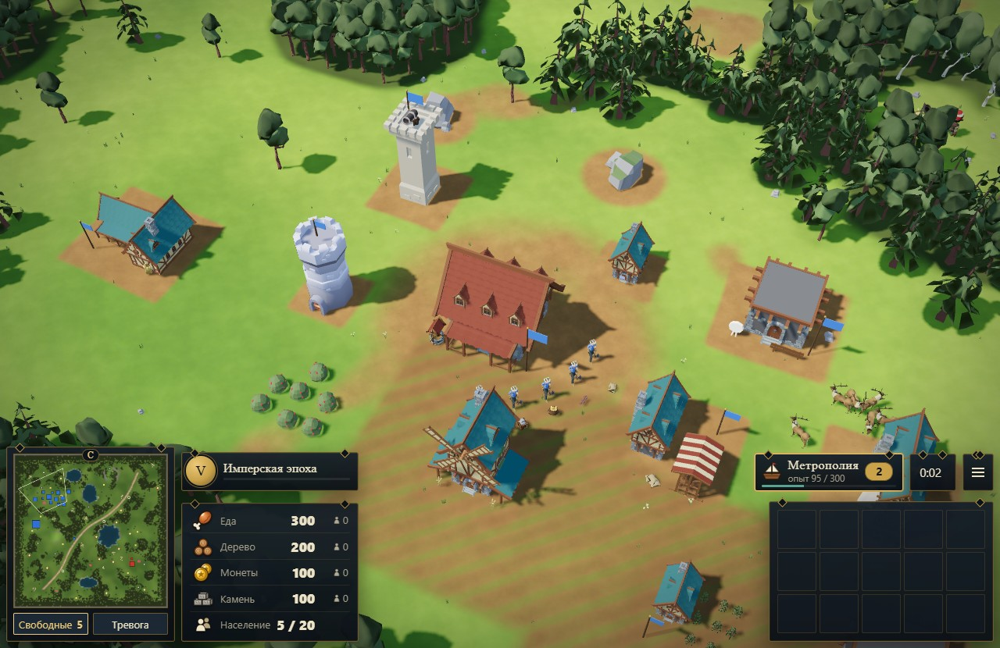
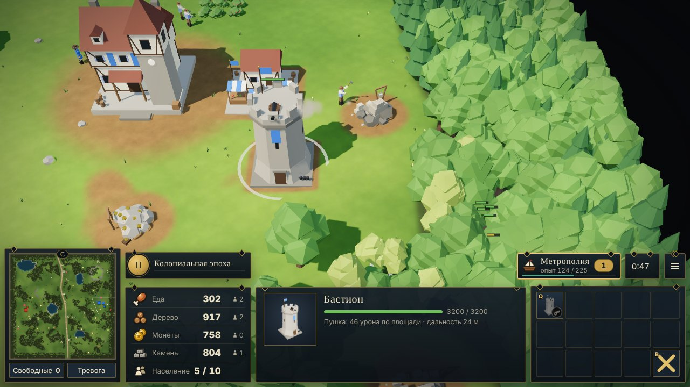

# Колонии Нового Света

Браузерная 3D-стратегия в реальном времени в духе Age of Empires III. Чистый JavaScript и Three.js r149: без фреймворков, бандлера и сервера. Сборка — один HTML-файл, который открывается в любом современном браузере. Можно сразу играть против ботов на большой карте.

**Играть онлайн:** https://ohehelv.github.io/ageofempires3/



## Что есть в игре

- 4 державы (Британия, Франция, Испания, Россия), у каждой свой бонус и уникальный юнит.
- 4 биома (Новая Англия, Великие равнины, Сонора, Юкон) и 3 размера карты, до 400×400 м.
- До трёх ботов, 4 уровня сложности, союзники или «каждый за себя».
- 5 эпох с выбором политика, метрополия с картами поставок (39 карт), опыт за всё, что делаете.
- 4 ресурса: еда, дерево, монеты, камень (каменоломни, бастионы, рынок).
- 18 типов юнитов, 14 зданий, 29 технологий, форт и фургоны, торговый путь с постами, сокровища под охраной.
- Туман войны, построения, атака с ходу, тревога в городском центре, рынок, советник с подсказками.
- Процедурные модели и анимация на GPU, вода, тени, частицы, процедурный звук.



## Запуск

```bash
npm install        # нужен только для тестов (three.js, Playwright)
npm run build      # → dist/index.html
```

Откройте `dist/index.html` в браузере. Three.js подгружается с jsDelivr, шрифты — с Google Fonts, всё остальное встроено в файл.

Управление: ЛКМ — выбор и рамка, ПКМ — приказ, колесо — масштаб, горячие клавиши Q…B — кнопки панели команд, F1 — полная справка в игре.

## Структура

```
shell.html          разметка и CSS: HUD, меню, модальные окна
build.mjs           склейка src/*.js в одну IIFE + shell.html → dist/index.html
src/
  01_util.js        математика, детерминированный RNG, шум, форматирование, Emitter
  02_data.js        все игровые таблицы: ресурсы, юниты, здания, технологии, эпохи, карты, биомы
  03_audio.js       процедурный звук (WebAudio)
  04_mapgen.js      генератор карты: рельеф, вода, лес, месторождения, сокровища, торговый путь
  05_nav.js         сетка проходимости и A*
  06_gfx_common.js  рендерер, материалы, шейдерные вставки, PartBuilder для моделей
  07_models.js      процедурные модели юнитов, зданий, деревьев и ресурсов
  08_world_render.js  сцена: небо, ландшафт, вода, туман войны, солнце
  09_instanced.js   инстансинг юнитов с GPU-анимацией, частицы, иконки-портреты
  10_entities.js    поведение юнитов, зданий, ресурсов
  11_game.js        игрок и игра: тик 20 Гц, бой, экономика, команды
  12_ai.js          боты
  13_render_sync.js синхронизация симуляции с графикой, эффекты
  14_input.js       камера, выбор, приказы, горячие клавиши
  15_ui.js          интерфейс: иконки, HUD, панель команд, миникарта, окна
  16_main.js        меню, фоновая партия ботов, игровой цикл
test/
  sim.cjs, sim2.cjs headless-партии ботов (логика без графики)
  run.cjs           браузерные тесты через Playwright, сценарии в test/actions/
docs/               скриншоты для README
```

Подробности архитектуры и правила для доработки — в [CLAUDE.md](CLAUDE.md).

## Тесты

```bash
npm test               # сборка + проверка синтаксиса + короткая партия ботов
npm run sim            # 20 минут партии двух сложных ботов без графики
npm run sim:ffa        # 4 бота на огромной карте
npm run sim:balance    # лёгкий бот против среднего
npx playwright install chromium   # один раз для браузерных тестов
npm run test:hud       # HUD, рынок, каменоломня, бастион — скриншоты в test/*.png
npm run test:flows     # фургон форта, рынок, тревога, сокровище, выкуп, торговый пост
```

## Публикация

`dist/index.html` — обычная статика: подойдёт любой хостинг (Nginx, Coolify со статикой, GitHub Pages и т. п.).
